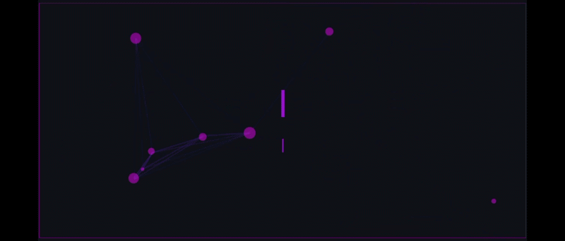

# 👋 &nbsp;Hi there

Hi, I'm Gyanendra Pandey, a Computer Science student passionate about Full-Stack Development, AI/ML, and Generative AI.

I enjoy building projects, exploring new technologies, and learning by solving real-world problems. Currently, I'm focused on improving my development, AI/ML, and problem-solving skills.

&nbsp;

## 🧰 &nbsp;My toolbox

           ! 

